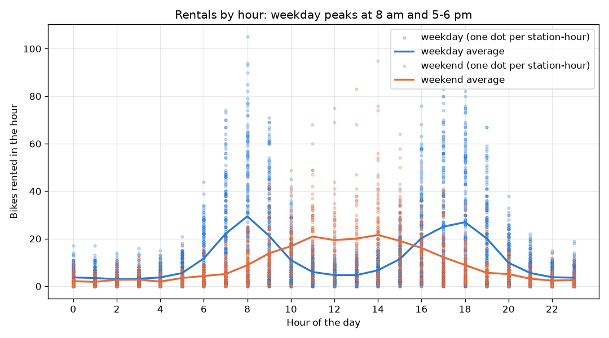
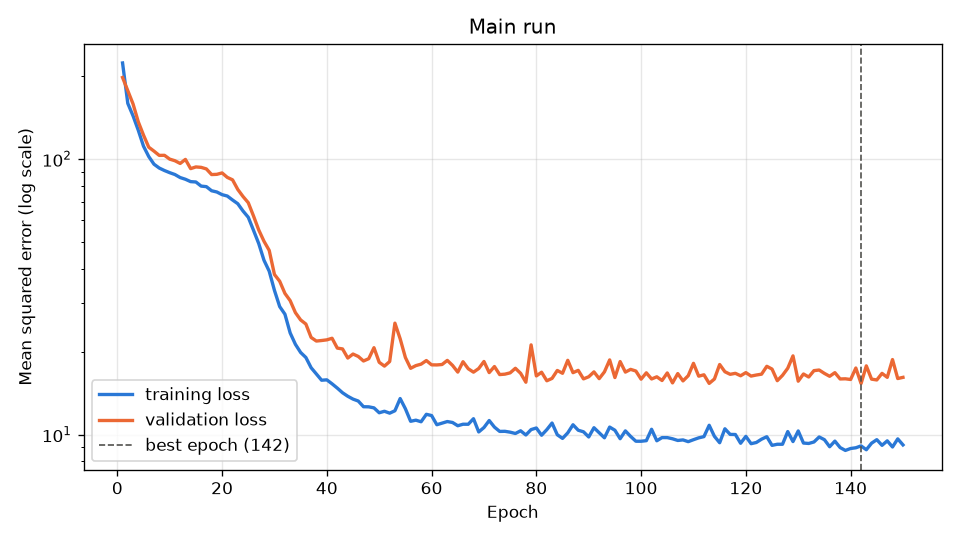
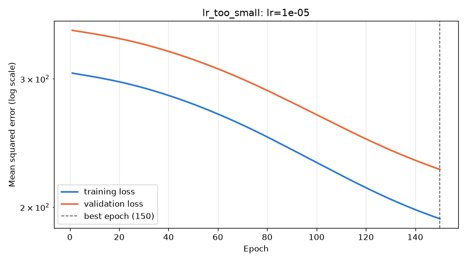
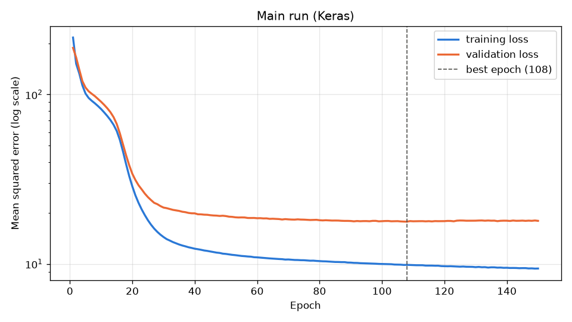

# Lakeshore Bike Demand: the same model in PyTorch and Keras

## What it does

Predicts how many bikes will be rented from a Lakeshore Bike Share station in the
coming hour, from the hour of the day, the weather, whether it is a weekend and the
type of station. A small neural network, trained with a loop written by hand in
PyTorch (Lab 07), is compared with two simple baselines on the same rows.

In Lab 08 the same network is built a second time in Keras. The two versions are
checked to compute the same function, trained with the same rows and settings on
three seeds, and compared. The written comparison and the framework recommendation
are in [COMPARISON.md](COMPARISON.md).

## How to run it

```bash
conda env create -f environment.yml
conda activate lab08-same-model-twice
python train.py          # PyTorch: main run and three experiments
python train_keras.py    # Keras: the main run
python compare.py        # both frameworks, three seeds (six models)
python -m ruff format --check .
python -m ruff check .
python -m pytest
```

- Each script takes less than a minute on my MacBook.
- `python train.py` recreates `history.csv`,
  `learning_curves.png`, `experiments.csv`, `metrics.json` and the three
  `curves_*.png` files in `reports/`.
- `python train_keras.py` recreates `history_keras.csv`,
  `learning_curves_keras.png` and `metrics_keras.json`.
- `python compare.py` trains six models and recreates `comparison.csv` and
  `equivalence.json`.
- `python keras_model.py` prints the Keras network and a quick equivalence check.
- `python explore.py` redraws the data plot `reports/rentals_by_hour.png`.
- `train_keras.py` saves the best Keras model to `models/bike_net_keras.keras`.
  It is a binary file (about 81 KB) that every run recreates, so `models/` is in
  `.gitignore` and the checkpoint is **not** committed.
- TensorFlow prints a few start-up messages. They are normal. Run
  `export TF_CPP_MIN_LOG_LEVEL=2` first to hide most of them.

## Data and split

- 6,000 station-hours from `bikes_data.py` (seed 2026), given and unchanged.
- The rows are split once, before any preparation: 60% training (3,600 rows), 20%
  validation (1,200) and 20% test (1,200), with `random_state=42`.
- Hour, temperature, rain, wind and weekend are standardized, and station type is
  one-hot encoded, giving 8 features per row.
- The scaler and the encoder are fitted on the training rows only, then applied to
  the validation and test rows. Fitting them on all rows would leak information
  from the validation and test rows into training.
- The validation rows choose the settings and the best epoch. The test rows are
  scored once, at the end.
- Keras uses exactly the same prepared rows: `keras_arrays()` in `train_keras.py`
  hands Keras the NumPy arrays behind the PyTorch tensors. Nothing is prepared a
  second time.

## Model and training

- `BikeNet`: Linear(8, 64), ReLU, Linear(64, 64), ReLU, Linear(64, 1). 4,801
  parameters. There is no activation at the end, because the target is a count,
  not a probability.
- Loss: mean squared error (`nn.MSELoss`). The mean absolute error (MAE) is
  reported in rentals.
- Optimizer: Adam with a learning rate of 0.003. Batches of 64 rows. Only the
  training batches are shuffled.
- 150 epochs. The validation loss is measured after every epoch, and the weights
  from the epoch with the lowest validation loss are put back at the end.
- Seeds: `torch.manual_seed(42)` before each network is built, and a
  `torch.Generator` seeded with 42 for the training loader. Running
  `python train.py` twice gives identical numbers on the same computer.

## Results

| Model | Validation MAE (rentals) | Test MAE (rentals) |
|---|---|---|
| Predict the training mean | 10.15 | 9.65 |
| Linear regression | 9.32 | 8.57 |
| Neural network, PyTorch (best epoch 142) | 2.59 | 2.50 |
| Neural network, Keras (best epoch 108) | 2.87 | 2.67 |

The linear model is barely better than predicting the mean. The plot of rentals
against the hour shows why: on weekdays rentals peak around 8 am and again around
5 to 6 pm, with a dip in between, while weekends peak in the early afternoon. A
straight line in the hour can only rise or fall across the day, so it cannot follow
two peaks, and it cannot let the effect of the hour change with the weekend or the
station type. The network can bend, so it learns these shapes.





Both losses fall steeply for about the first 50 epochs. After that the validation
loss moves between about 15 and 18 while the training loss creeps down to about 9,
so the network has started to fit noise in the training rows. The lowest
validation loss is at epoch 142, and those are the weights kept. The test MAE
(2.50) is close to the validation MAE (2.59), so the validation rows gave a fair
picture. The counts are random, so even a perfect model makes errors: for counts
like these the squared error cannot fall much below the average count, about 10.6.

## Experiments

Each run changes one setting from the main run. Everything else, including the
seed and the rows, stays the same.

| Run | Change | Best epoch | Best val MAE | Final train loss | Final val loss |
|---|---|---|---|---|---|
| main | none | 142 | 2.592 | 9.178 | 16.135 |
| lr_too_small | lr=1e-05 | 150 | 9.216 | 192.769 | 225.327 |
| lr_too_large | lr=0.3 | 149 | 3.634 | 26.946 | 38.123 |
| very_wide | hidden=512 | 43 | 2.613 | 6.298 | 20.255 |

"Best val MAE" is the validation MAE of the weights kept, from the best epoch.

- **main: fine.** Both curves fall together and flatten, and the gap stays modest.
- **lr_too_small: underfitting.** Both losses are still high and still falling
  slowly at epoch 150, and the best epoch is the last one. The network has hardly
  started learning, and its MAE (9.2) is no better than linear regression.
- **lr_too_large: unstable.** The loss drops quickly at first, then jumps up and
  down every few epochs instead of settling, because each step overshoots. It ends
  clearly worse than the main run.
- **very_wide: overfitting.** 512 units per layer means about 268,000 parameters
  for 3,600 rows. The training loss keeps falling to about 6, but the validation
  loss is lowest at epoch 43 and then drifts up to about 20. The extra width
  memorizes the training rows instead of learning more about demand.




## The Keras version

**What I built.** `keras_model.py` builds the same network with
`keras.Sequential`: Dense(64, ReLU), Dense(64, ReLU), Dense(1) with no activation.
The hidden size and the number of hidden layers are arguments, like in `BikeNet`.
The parameter count is the same as PyTorch's (4,801 for the main run), and a test
checks this for four different sizes. `train_keras.py` trains it with `compile`
and `fit`.

**The same settings.**

| Setting | PyTorch (`train.py`) | Keras (`train_keras.py`) |
|---|---|---|
| Rows | `make_splits(42)` | the same arrays, from `keras_arrays()` |
| Loss | `nn.MSELoss()` | `"mse"` |
| Optimizer | Adam, lr 0.003, eps 1e-8 | Adam, lr 0.003, epsilon set to 1e-8 (Keras default is 1e-7) |
| Batch size, epochs | 64, 150 | 64, 150 |
| Seed | `torch.manual_seed(42)` | `keras.utils.set_random_seed(42)` |
| Best epoch | kept by hand in `train()` | `EarlyStopping(patience=150, restore_best_weights=True)` |
| Saved model | none | `ModelCheckpoint(save_best_only=True)` |
| Logged every epoch | train loss, val loss, val MAE | the same, in `history_keras.csv` |

The patience equals the number of epochs, so EarlyStopping never stops early and
both versions train for 150 epochs. Three things cannot be made identical: the
starting weights (Keras uses Glorot uniform weights and zero biases, PyTorch its
own scheme), the order in which each framework shuffles the batches, and a small
detail in where each Adam adds its epsilon. So the seeds make each framework
repeatable, not identical to the other.

**The equivalence check.** `copy_torch_into_keras()` copies every PyTorch Linear
layer into the matching Keras Dense layer. PyTorch stores a weight as (outputs,
inputs) and Keras stores a kernel as (inputs, outputs), so each weight is
transposed. With the same weights, the largest gap between the two networks'
predictions on the 1,200 validation rows is 8.9e-08 rentals for an untrained
network and 3.1e-05 rentals for the trained PyTorch main run, inside the
stated tolerance of 1e-04 (`reports/equivalence.json`). The two versions are the
same function.



**Results over three seeds** (`reports/comparison.csv`). Each final model was
scored on the test rows once. Times are for one 150-epoch run on my MacBook's CPU
and change a little on every run; every other number repeats exactly. The
seed-42 rows are the same runs as `train.py` and `train_keras.py`.

| Framework | Seed | Best epoch | Val MAE | Test MAE | Seconds |
|---|---|---|---|---|---|
| PyTorch | 42 | 142 | 2.592 | 2.501 | 2.5 |
| Keras | 42 | 108 | 2.870 | 2.665 | 4.7 |
| PyTorch | 1 | 123 | 2.559 | 2.532 | 2.2 |
| Keras | 1 | 106 | 2.692 | 2.608 | 4.7 |
| PyTorch | 2 | 143 | 2.652 | 2.522 | 2.1 |
| Keras | 2 | 139 | 2.794 | 2.653 | 4.7 |
| **PyTorch, mean** | | | **2.601** | **2.518** | **2.3** |
| **Keras, mean** | | | **2.785** | **2.642** | **4.7** |

Both frameworks land far below the baselines (test MAE 8.57 for linear
regression). PyTorch was a little more accurate on all three seeds, by about 0.12
rentals on the test rows, and about twice as fast on this small network. What
this means for the team, and which framework I recommend, is in
[COMPARISON.md](COMPARISON.md).

## Tests

`python -m pytest` runs 30 tests: the 13 from Lab 07 and 17 new ones in
`tests/test_keras.py`.

- **Lab 07 (PyTorch):** the split adds up and does not overlap, the scaler is
  fitted on training rows only, the loader shuffles repeatably, the network
  returns one value per row, one step changes every layer, the network can
  memorize a small batch, `zero_grad` and `step` run once per batch, validation
  leaves the weights alone, and the best weights are put back.
- **Keras network:** one value per row; the same parameter count as PyTorch for
  four sizes (the parametrized test).
- **Weight copy:** after the copy both networks predict the same values, including
  a size with square kernels where a forgotten transpose would not fail on shape;
  and a copy that reshapes instead of transposing is caught.
- **Same rows:** the arrays given to Keras equal the tensors given to PyTorch.
- **Training:** the Keras network memorizes one small batch; a saved and
  reloaded model predicts the same; the best weights are restored and the
  checkpoint holds the best epoch (using validation rows whose loss can only
  rise, so the best epoch is not the last); every epoch is logged; the same seed
  repeats a short run and another seed does not.
- **Comparison:** predictions of shape (N, 1) are flattened before the MAE;
  `compare()` trains both frameworks on every seed and returns the right columns.

pytest also prints a few `DeprecationWarning` lines from inside Keras when it
loads a saved model. They come from the library, not from this code, and the
tests pass.

## Limitations

- The data are invented by `bikes_data.py`. They represent no real city, station
  or riders, so the results show how the method works, not how real stations
  behave.
- The model only sees the hour, the weather, the weekend flag and the station type.
  It cannot see holidays, events, road closures, station capacity, how many bikes
  are docked, or what happened in the previous hour.
- It predicts an average. Real counts vary around it, by about 2.5 bikes on
  average, so it should be one input to planning crews, not an exact count.
- It has not been tested on another season, year or city, and it should not be
  used for decisions about individual riders or for anything safety-critical.
- The framework comparison uses one small network, three seeds and one MacBook's
  CPU. The times would change on another computer or with a larger model, and
  three seeds cannot show whether a gap of about 0.1 rentals is real.
