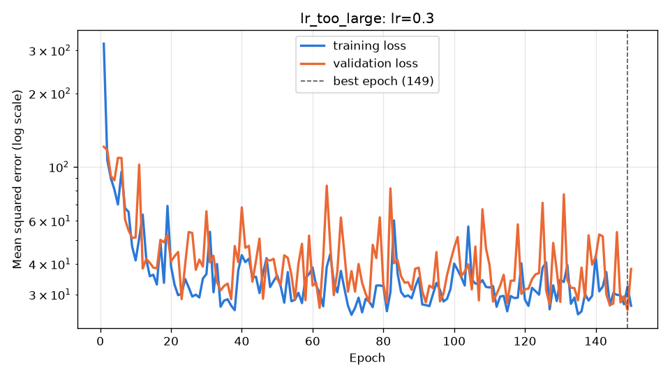
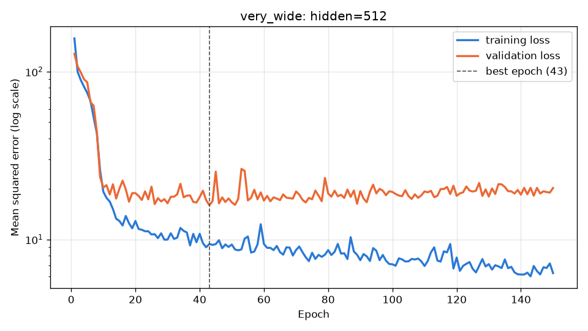

# Lakeshore Bike Demand

## What it does

Predicts how many bikes will be rented from a Lakeshore Bike Share station in the
coming hour, from the hour of the day, the weather, whether it is a weekend and the
type of station. A small neural network, trained with a loop written by hand in
PyTorch, is compared with two simple baselines on the same rows.

## How to run it

```bash
conda env create -f environment.yml
conda activate lab07-first-principles
python train.py
python -m ruff format --check .
python -m ruff check .
python -m pytest
```

`python train.py` takes about a minute on a laptop CPU and recreates every file in
`reports/`. `python explore.py` redraws the data plot `reports/rentals_by_hour.png`.

## Data and split

- 6,000 station-hours from `bikes_data.py` (seed 2026), given and unchanged.
- The rows are split once, before any preparation: 60% training (3,600 rows), 20%
  validation (1,200) and 20% test (1,200), with `random_state=42`.
- Hour, temperature, rain, wind and weekend are standardized, and station type is
  one-hot encoded, giving 8 features per row.
- The scaler and the encoder are fitted on the training rows only, then applied to
  the validation and test rows. Fitting them on all rows would leak information
  from the validation and test rows into training.
- The validation rows choose the settings and the best epoch. The test rows are
  scored once, at the end.

## Model and training

- `BikeNet`: Linear(8, 64), ReLU, Linear(64, 64), ReLU, Linear(64, 1). 4,801
  parameters. There is no activation at the end, because the target is a count,
  not a probability.
- Loss: mean squared error (`nn.MSELoss`). The mean absolute error (MAE) is
  reported in rentals.
- Optimizer: Adam with a learning rate of 0.003. Batches of 64 rows. Only the
  training batches are shuffled.
- 150 epochs. The validation loss is measured after every epoch, and the weights
  from the epoch with the lowest validation loss are put back at the end.
- Seeds: `torch.manual_seed(42)` before each network is built, and a
  `torch.Generator` seeded with 42 for the training loader. Running
  `python train.py` twice gives identical numbers on the same computer.

## Results

| Model | Validation MAE (rentals) | Test MAE (rentals) |
|---|---|---|
| Predict the training mean | 10.15 | 9.65 |
| Linear regression | 9.32 | 8.57 |
| Neural network (best epoch 113) | 2.58 | 2.51 |

The linear model is barely better than predicting the mean. The plot of rentals
against the hour shows why: on weekdays rentals peak around 8 am and again around
5 to 6 pm, with a dip in between, while weekends peak in the early afternoon. A
straight line in the hour can only rise or fall across the day, so it cannot follow
two peaks, and it cannot let the effect of the hour change with the weekend or the
station type. The network can bend, so it learns these shapes.


Both losses fall steeply for the first 40 epochs. After about epoch 60 the
validation loss flattens at about 16 while the training loss keeps creeping down to
about 9, so the network has started to fit noise in the training rows. The lowest
validation loss is at epoch 113, and those are the weights kept. The test MAE
(2.51) is close to the validation MAE (2.58), so the validation rows gave a fair
picture. The counts are random, so even a perfect model makes errors: for counts
like these the squared error cannot fall much below the average count, about 10.6.

## Experiments

Each run changes one setting from the main run. Everything else, including the
seed and the rows, stays the same.

| Run | Change | Best epoch | Best val MAE | Final train loss | Final val loss |
|---|---|---|---|---|---|
| main | none | 113 | 2.576 | 9.180 | 16.345 |
| lr_too_small | lr=1e-05 | 150 | 9.216 | 192.769 | 225.327 |
| lr_too_large | lr=0.3 | 143 | 3.743 | 26.964 | 40.412 |
| very_wide | hidden=512 | 43 | 2.607 | 6.274 | 20.084 |

"Best val MAE" is the validation MAE of the weights kept, from the best epoch.

- **main: fine.** Both curves fall together and flatten, and the gap stays modest.
- **lr_too_small: underfitting.** Both losses are still high and still falling
  slowly at epoch 150, and the best epoch is the last one. The network has hardly
  started learning, and its MAE (9.2) is no better than linear regression.
- **lr_too_large: unstable.** The loss drops quickly at first, then jumps up and
  down every few epochs instead of settling, because each step overshoots. It ends
  clearly worse than the main run.
- **very_wide: overfitting.** 512 units per layer means about 268,000 parameters
  for 3,600 rows. The training loss keeps falling to about 6, but the validation
  loss is lowest at epoch 43 and then drifts up to about 20. The extra width
  memorizes the training rows instead of learning more about demand.






## Limitations

- The data are invented by `bikes_data.py`. They represent no real city, station
  or riders, so the results show how the method works, not how real stations
  behave.
- The model only sees the hour, the weather, the weekend flag and the station type.
  It cannot see holidays, events, road closures, station capacity, how many bikes
  are docked, or what happened in the previous hour.
- It predicts an average. Real counts vary around it, by about 2.5 bikes on
  average, so it should be one input to planning crews, not an exact count.
- It has not been tested on another season, year or city, and it should not be
  used for decisions about individual riders or for anything safety-critical.